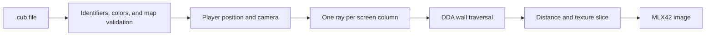

# cub3D

A textured first-person view drawn from a two-dimensional map using raycasting.

[Repository](../README.md) · **C / MLX42 / graphics** · **Score: 125** · **Team project**

## Rendering the scene

The renderer casts one ray for each screen column. A DDA traversal steps through the map grid until it hits a wall, calculates perpendicular wall distance, and projects a textured vertical slice. The hit side and ray direction select the north, south, east, or west texture. Floor and ceiling use the colors from the map file.

Player state consists of a position, a direction vector, and a perpendicular camera plane. Movement checks nearby map cells for collisions; rotation updates both vectors. The mandatory window is 1024 × 640.



## Map format

The checked-in examples are [Mandatory/map.cub](Mandatory/map.cub) and [bonus/map_bonus.cub](bonus/map_bonus.cub). Each begins with `NO`, `SO`, `WE`, and `EA` PNG texture paths, then `F` and `C` RGB triples, followed by the map.

`1` marks walls, `0` open space, and one `N`, `S`, `E`, or `W` gives the starting position and direction. The parser pads shorter rows with spaces, checks identifiers and RGB ranges, and rejects open tiles adjacent to the map edge or empty space. The bonus accepts `D` doors and uses `O` for their open state.

Texture paths resolve from the process's current directory, so run the game from `cub3D/`.

## Build and run

The supplied Makefile targets **macOS**: it uses OpenGL and AppKit, Homebrew's GLFW library path, CMake, and Make. MLX42 is included in [.MLX42/](.MLX42/), with a local header at `.MLX42.h`. The build also compiles `libft` and `AllocFreeCraft`.

```bash
make
./cub3D Mandatory/map.cub
make bonus
./cub3D_bonus bonus/map_bonus.cub
```

**Case-sensitive filesystem note:** the mandatory source directory is named `Mandatory`, but the Makefile's source paths use `mandatory`. That target needs matching path capitalization on a case-sensitive filesystem. These commands also require the graphics dependencies; they are not a platform-independent build recipe.

| Control | Action |
| --- | --- |
| W / A / S / D | Move and strafe |
| Left / right arrow | Rotate |
| Escape or window close | Exit |
| M, then horizontal mouse movement | Enable bonus mouse rotation and cursor capture |
| O near a door | Open a bonus door; it closes after moving away |
| Left mouse click | Switch the bonus hand/knife overlay |
| Up / down arrow | Adjust the bonus dragon overlay's height |

## Bonus and organization

The bonus adds a circular minimap, door interaction, mouse rotation, a three-frame dragon overlay, and a switchable hand/knife overlay. These are drawn as screen overlays; the code does not implement dragon enemies or combat.

| Path | Purpose |
| --- | --- |
| [Mandatory/](Mandatory/) | Mandatory entry point, controls, and DDA renderer |
| [Mandatory/youbella/map_data/](Mandatory/youbella/map_data/) | Identifier parsing, colors, map loading, and validation |
| [bonus/](bonus/) | Extended renderer, minimap, controls, and overlay assets |
| [walls_images/](walls_images/) | Directional wall textures |
| [AllocFreeCraft/](AllocFreeCraft/) | Allocation registry for individual pointers and string arrays |
| [libft/](libft/) | Local copy of the C utility library |

`AllocFreeCraft` stores tracked pointers in a linked list for grouped cleanup. It is a support library for this game, not a separate curriculum project.

## Manual checks

With the graphics dependencies available, load each supplied map, inspect wall textures while rotating, and test movement against corners. In the bonus, check the minimap, door opening/closing, mouse rotation, and overlay controls. Copies of the map with a missing identifier, an out-of-range RGB component, or an open boundary exercise validation.

No automated renderer tests are bundled. `make clean` removes objects and the MLX42 build directory; `make fclean` also removes the executables and library archives.

[Project subject](../Subjects/cub3D.subject.pdf) · [Back to 1337 Curses](../README.md)
