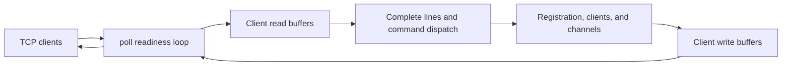

# ft_irc

An IRC server in C++98, with non-blocking clients, channels, operator commands, and a small channel bot.

[Repository](../README.md) · **C++98 / TCP sockets / poll** · **Score: 125**

*Created as part of the curriculum by [youbella](https://profile.intra.42.fr/users/youbella) and [wkannouf](https://profile.intra.42.fr/users/wkannouf).*

## Server architecture

One `poll()` loop handles the listening socket and connected clients. Sockets are non-blocking. Each client keeps a read buffer for incomplete input and a write buffer for queued replies, so a command can arrive across several reads and a reply can be sent across several writes.



Input is dispatched only after a newline arrives; an optional preceding carriage return is removed. The server enforces a 512-byte IRC line limit. Clients register in `PASS`, `NICK`, `USER` order before using channel commands. Channel names are normalized to lowercase, and the first member of a new channel becomes its operator.

This is a selected IRC client-command implementation. It does not implement every command described by the protocol references.

## Build and start

Use Make and a C++ compiler on a Unix-like platform with sockets, `fcntl`, and `poll`. The Makefile uses `c++ -Wall -Wextra -Werror -std=c++98`.

```bash
make
./ircserv 6667 testpass
```

Arguments are a port in the range 1–65535 and a connection password. Use an available unprivileged port for local checks. The server listens on IPv4 interfaces and runs until interrupted.

## Connect and exchange messages

In another terminal, open a plain TCP connection:

```bash
nc 127.0.0.1 6667
```

Type these protocol lines:

```text
PASS testpass
NICK alice
USER alice 0 * :Alice
JOIN #general
PING hello
PRIVMSG #general :!help
```

`PING hello` receives `PONG :hello`. The last line asks the channel bot for its commands. Open a second connection, register as `bob`, and join `#general` to test channel messages and `PRIVMSG bob :hello` from Alice.

## Commands and channel modes

| Commands | Purpose |
| --- | --- |
| `PASS`, `NICK`, `USER` | Authentication and registration |
| `PING`, `QUIT` | Connection check and disconnect |
| `JOIN`, `PART` | Channel membership; `JOIN #one,#two` is supported |
| `PRIVMSG` | Direct or channel messages |
| `KICK`, `INVITE` | Operator-controlled membership |
| `TOPIC`, `MODE` | Channel topic and settings |

| Mode | Effect |
| --- | --- |
| `+i` / `-i` | Enable/disable invitation-only joining |
| `+t` / `-t` | Restrict topic changes to operators / allow members |
| `+k <key>` / `-k` | Set/remove a channel key |
| `+o <nick>` / `-o <nick>` | Grant/remove operator status |
| `+l <limit>` / `-l` | Set/remove a positive user limit |

Simple combinations of `i` and `t`, such as `+it` and `-it`, are handled together. Parameterized modes are handled individually. New channels start with operator-only topic changes enabled.

## Bot and file-transfer offers

Channel messages beginning with `!` reach `IRCBot`: `!help`, `!time`, `!dice [max]`, `!users`, `!topic`, and `!ping`. Its replies are broadcast to channel members.

Direct messages containing a CTCP `DCC SEND` offer are forwarded to the recipient. The server extracts the filename and size and adds an informational notice. It does not transfer or store the file bytes; compatible clients handle that connection separately.

## Source map and checks

| File | Responsibility |
| --- | --- |
| [src/server.cpp](src/server.cpp) | Socket setup, event loop, buffering, and disconnect cleanup |
| [src/client.cpp](src/client.cpp) | Registration flags and per-client input/output buffers |
| [src/command_handler.cpp](src/command_handler.cpp) | Command dispatch and permission checks |
| [src/parse.cpp](src/parse.cpp) | Command-specific parameter parsing |
| [src/channel.cpp](src/channel.cpp) | Members, operators, invitations, topic, key, and user limit |
| [src/bot.cpp](src/bot.cpp), [src/fileTransfer.cpp](src/fileTransfer.cpp) | Bot replies and DCC-offer metadata |
| [inc/](inc/) | Class interfaces |

Manual checks include a wrong password, a duplicate nickname, multiple clients in one channel, invitation-only access, operator changes, and a command sent in several fragments before its terminating newline. There is no bundled automated server test suite.

`make clean` removes objects, `make fclean` also removes `ircserv`, and `make re` rebuilds it.

## Resources

- [Project subject](../Subjects/ft_irc.subject.pdf)
- [RFC 2811 — Channel Management](https://datatracker.ietf.org/doc/html/rfc2811)
- [RFC 2812 — Client Protocol](https://datatracker.ietf.org/doc/html/rfc2812)
- [Beej's Guide to Network Programming](https://beej.us/guide/bgnet/)

### AI usage

The existing project notes record AI assistance with code review and thinking about test cases.

[Back to 1337 Curses](../README.md)
