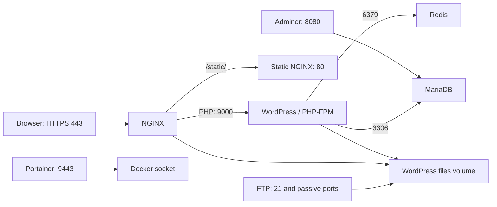

# Inception

A WordPress deployment assembled from service-specific Docker images and managed with Docker Compose.

[Repository](../README.md) · **Docker / Compose / Linux administration** · **Score: 125**

*Created as part of the 42 curriculum by youbella.*

## Services and request flow

Every image in this checkout starts from `debian:bookworm-slim`. Dockerfiles install the service packages and copy their configuration or startup scripts. The Compose file starts the core services **and all five bonus services together**; there is no separate bonus target.



| Service | Role and access |
| --- | --- |
| NGINX | HTTPS on host port 443; self-signed certificate and TLS 1.2/1.3; sends PHP requests to `wordpress:9000`. |
| WordPress | PHP-FPM, with installation and user setup through WP-CLI; no host port published. |
| MariaDB | WordPress database at `mariadb:3306`; no host port published. |
| Redis | Internal object cache at `redis:6379`, enabled through the WordPress Redis Object Cache plugin. |
| Static website | Separate NGINX container reached through `https://youbella.42.fr/static/`. |
| FTP | Shared WordPress-file access on host port 21 and passive ports 10000–10100. |
| Adminer | Database administration at `http://VM_IP:8080`; use `mariadb` as the server. |
| Portainer | Docker management at `https://VM_IP:9443`, with its own first-run administrator account. |

All services join the `inception` network and use `restart: always`. Startup scripts run their final service in the foreground. WordPress waits for Redis's healthcheck and retries MariaDB authentication up to 30 times, two seconds apart.

## Setup

The supplied paths target a **Linux VM** with Docker Engine, the Docker Compose plugin, Make, and permission to use Docker and create `/home/youbella/data/`. Building and first startup also need network access to the package and application download sources used by the Dockerfiles and scripts.

Run commands from this directory. Create `srcs/.env`; it is required by Compose and is not included in this checkout. Use your own values for the accounts and database:

| Variable | Purpose |
| --- | --- |
| `DOMAIN_NAME` | Use `youbella.42.fr`, matching the NGINX server name. |
| `MYSQL_DATABASE` | Database to create for WordPress. |
| `MYSQL_ROOT_PASSWORD` | MariaDB root password. |
| `USER`, `PASSWORD` | Database user, initial WordPress administrator, and FTP account. |
| `WP_USER`, `WP_USER_PASSWORD`, `WP_USER_EMAIL` | Editor account settings; defaults exist in the setup script. |
| `WP_ADMIN_EMAIL` | Optional administrator email. |
| `WORDPRESS_VERSION`, `WP_CLI_VERSION` | Optional download version overrides; defaults are in `wordpress/tools/setup.sh`. |
| `FTP_PASV_ADDRESS` | Optional reachable host/VM address for passive FTP. |

For the evaluation setup, choose an administrator username without `admin` or `Admin`. On the machine running the browser, map the domain to the VM in `/etc/hosts`:

```text
VM_IP youbella.42.fr
```

Replace `VM_IP` with the Docker host's actual address. For Docker Desktop on macOS, use `127.0.0.1` for that hosts entry and adapt the `/home/youbella/data/` paths consistently in both Makefile and Compose before running. The checked-in Makefile does not perform that adaptation.

## Build, run, and inspect

```bash
make          # Create host data directories, build images, start all services
make ps       # Container status
make logs     # Follow service logs; Ctrl-C leaves containers running
make down     # Remove containers and network, keeping saved data
```

Open `https://youbella.42.fr` and expect a self-signed certificate warning. The dashboard is at `/wp-admin/`. The main site does not publish HTTP port 80.

The WordPress script downloads missing files, creates missing configuration, installs the site if needed, ensures an editor exists, and enables Redis caching. Reusing the volumes reuses the existing site.

```bash
docker compose -f srcs/docker-compose.yml exec nginx nginx -t
docker compose -f srcs/docker-compose.yml exec wordpress wp core is-installed --allow-root
docker compose -f srcs/docker-compose.yml exec wordpress wp redis status --allow-root
docker compose -f srcs/docker-compose.yml exec redis redis-cli ping
```

These are manual service checks. Test persistence by changing a page, running `make down` followed by `make`, and checking that the edit remains. No automated deployment test is bundled.

## Storage and configuration choices

| Named volume | Host directory | Mounted data |
| --- | --- | --- |
| `wordpress_data` | `/home/youbella/data/wordpress` | `/var/www/html`, shared by WordPress, NGINX, and FTP |
| `mariadb_data` | `/home/youbella/data/mariadb` | `/var/lib/mysql` |
| `portainer_data` | `/home/youbella/data/portainer` | Portainer's `/data` |

These are named local-driver volumes backed by host directories using `type: none` and `o: bind`. `make fclean` removes project containers, images, and named volume definitions; it does not delete those host directories. `make re` runs that cleanup and starts again, so it does not reset the saved site. Redis has no persistent volume; the static page is copied into its image.

A VM runs its own guest kernel; these containers share the Docker host's kernel. The project's bridge network keeps service-name communication separate from published host ports, instead of using host networking. The named volumes provide Docker-managed references to the explicit host storage paths.

Configuration is passed through `.env`, not Docker secrets. Credentials are available in container environments. FTP is configured without TLS; Redis has no authentication configured and is not published to the host. Portainer mounts `/var/run/docker.sock`, giving it access to manage Docker on the host. These are the actual configuration choices in this project.

Changing `.env` does not update an existing WordPress login password. MariaDB reapplies configured database credentials at startup, while an existing `wp-config.php` keeps its saved database password. Coordinate changes using the [developer guide](DEV_DOC.md).

## Layout and further documentation

```text
Makefile
srcs/
  docker-compose.yml
  requirements/
    nginx/         HTTPS configuration and certificate setup
    wordpress/     PHP-FPM configuration and WP-CLI initialization
    mariadb/       Database configuration and initialization
    bonus/         Redis, FTP, static site, Adminer, and Portainer
```

[USER_DOC.md](USER_DOC.md) covers daily operation and service access. [DEV_DOC.md](DEV_DOC.md) covers environment setup, container commands, credentials, and data storage.

## Resources

- [Project subject](../Subjects/inception.subject.pdf)
- [Docker documentation](https://docs.docker.com/) and [NGINX documentation](https://nginx.org/en/docs/)
- [WP-CLI commands](https://developer.wordpress.org/cli/commands/) and [MariaDB documentation](https://mariadb.com/docs/)
- [Redis Object Cache](https://wordpress.org/plugins/redis-cache/), [Adminer](https://www.adminer.org/), and [Portainer documentation](https://docs.portainer.io/)

### AI usage

The existing project notes record AI assistance with explaining Docker concepts, reviewing Compose and setup scripts, and preparing configuration changes and documentation.

[Back to 1337 Curses](../README.md)
