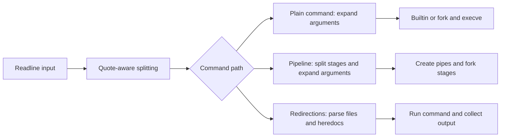

# minishell

An interactive shell with quoting, environment expansion, builtins, pipelines, and redirections.

[Repository](../README.md) · **C / Unix processes / Readline** · **Score: 101**

## From prompt to process

The shell reads a command with Readline, adds it to history, and splits it while tracking single and double quotes. Expansion substitutes environment variables and `$?` outside single quotes, then removes syntactic quotes from arguments. Unclosed quotes produce a syntax error.

Execution takes different paths for plain commands, pipelines, and commands with redirections:



This is a small shell implementation, with separate execution paths rather than a general shell syntax tree. It does not implement the subject's `&&`, `||`, parentheses, or wildcard bonus.

## Implemented behavior

| Area | Details |
| --- | --- |
| Builtins | `echo`, `cd`, `pwd`, `export`, `unset`, `env`, `exit` |
| Executables | Explicit paths and lookup through `PATH`, followed by `fork` / `execve` |
| Expansion | `$NAME`, `$?`, single-quote suppression, and expansion inside double quotes |
| Pipes | Quote-aware stage splitting, pipe creation, descriptor duplication, and child waits |
| Redirections | `<`, `>`, `>>`, and `<<`; quoted heredoc delimiters suppress body expansion |
| Environment | Linked-list state, sorted `export` display, `NAME+=value`, and working-directory updates |
| Interactive control | Readline history, EOF exit, and handlers for SIGINT and SIGQUIT |

Plain state-changing builtins run in the shell process. Pipeline stages run in children. Redirection execution collects text through additional pipes and returns it to the caller; large streams should be checked separately rather than assuming the same streaming behavior as Bash.

## Build and launch

The Makefile expects **macOS with Homebrew Readline**, a C compiler, Make, and **Norminette**. It derives Readline include/library paths from `brew --prefix readline` and runs Norminette during compilation. Its bundled `libft` also includes macOS headers.

```bash
make
./minishell
```

Launch it in an interactive terminal without arguments; it does not offer a `-c` mode. The build creates `minishell` and builds the local `libft` archive automatically.

## Try it

Enter these lines at the shell's prompt:

```bash
pwd
export GREETING=hello
echo "$GREETING"
echo '$GREETING'
ls | wc -l
echo first > notes.txt
echo second >> notes.txt
cat < notes.txt
cat << END
hello from a heredoc
END
unset GREETING
exit
```

`notes.txt` is created in the current directory. Ctrl-D exits at an empty prompt. Check Ctrl-C at the prompt, during a foreground command, and while reading a heredoc, since each uses a different signal path.

## Source map

| Directory | Responsibility |
| --- | --- |
| [split_commands/](split_commands/) | Quote state, argument splitting, expansion, and redirect tokenization |
| [commands/](commands/) | Builtins, `PATH` lookup, and the interactive command loop |
| [enviroment/](enviroment/) | Environment and export state; spelling follows the source directory |
| [pipe/](pipe/) | Pipeline descriptors, child processes, and waiting |
| [redirections/](redirections/) | File redirections, heredocs, and captured command output |
| [free_leaks/](free_leaks/) | Cleanup of tracked allocations |
| [minishell.c](minishell.c) | Startup, terminal configuration, signals, and status storage |

## Checks and cleanup

The commands above provide a manual walkthrough. Also try an unknown command, an unclosed quote, a missing input file, and `echo $?` after a failure. Compare individual cases with Bash where useful; this is not a claim of full Bash compatibility. There is no bundled shell test suite.

`make clean` removes project and library objects, `make fclean` also removes the executable and archive, and `make re` rebuilds them.

[Project subject](../Subjects/minishell.subject.pdf) · [Back to 1337 Curses](../README.md)
